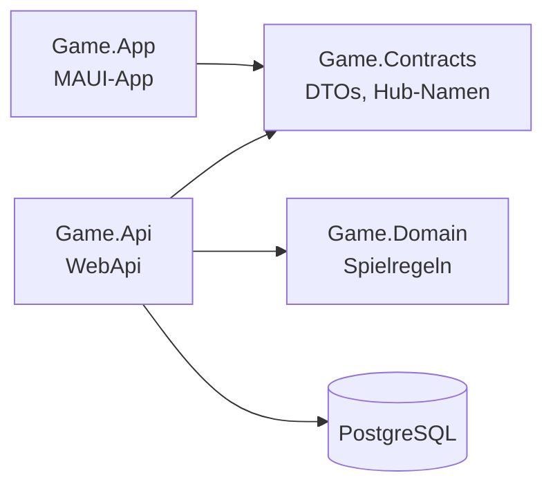
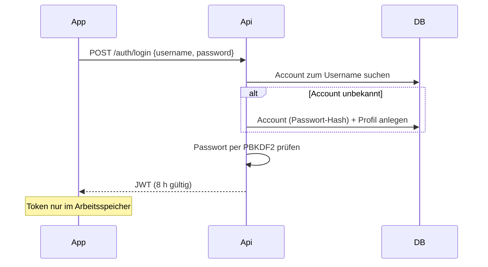
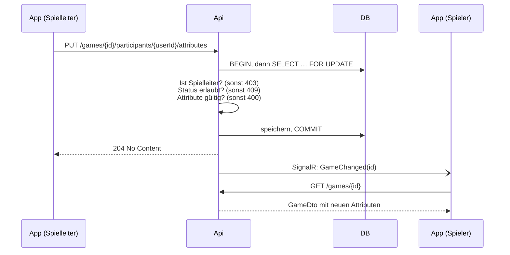
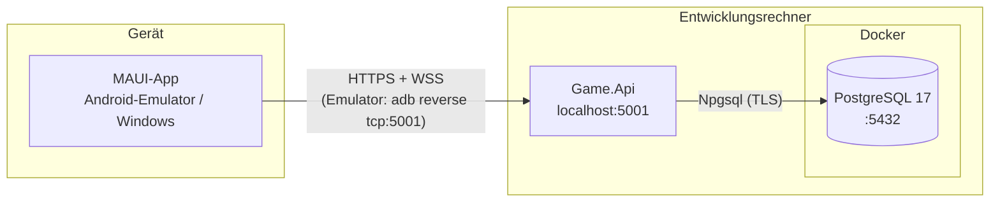

# Architekturdokumentation – Spielleiter-App

Aufbau nach arc42, Kapitel 4–12. Kapitel 1–3 (Einführung und Ziele, Randbedingungen,
Kontextabgrenzung) stehen in [requirements.md](requirements.md), die einzelnen
Architekturentscheidungen in [docs/adr](adr/README.md).

## 4. Lösungsstrategie

| Ziel / Anforderung | Lösungsansatz | Details |
|---|---|---|
| Saubere, testbare Architektur | Spielregeln in einer reinen Domain-Schicht ohne Abhängigkeiten; Api und App teilen sich nur die DTOs (`Game.Contracts`) | [ADR-0001](adr/0001-solution-struktur.md) |
| Rollen pro Spiel | Spielleiter ist, wer das Spiel erstellt; Prüfung pro Ressource statt globaler Rollen | [ADR-0002](adr/0002-spielleiter-modell.md) |
| Dynamische Attribute | Key-Value-Paare in eigener Tabelle, der Spielleiter ersetzt die Liste als Ganzes | [ADR-0003](adr/0003-dynamische-attribute.md) |
| Live-Updates | SignalR sendet nur Signale, Daten kommen immer per REST (eine einzige Stelle für Autorisierung) | [ADR-0004](adr/0004-live-updates-signalr.md) |
| Konsistenz bei Nebenläufigkeit | Jede Änderung sperrt die Game-Zeile (`SELECT … FOR UPDATE`) in einer Transaktion | [ADR-0005](adr/0005-nebenlaeufigkeit.md) |
| Eindeutige Regeln | Zustandsautomat Lobby → Running → Finished in der Domain-Klasse `Game` | [ADR-0006](adr/0006-spielzustand-und-regeln.md) |
| Authentifizierung ohne externen Dienst (AC05) | Die Api verwaltet Konten selbst (PBKDF2) und stellt eigene JWTs aus | [ADR-0008](adr/0008-authentifizierung.md) |
| Einheitliche Fehler | Zentraler Exception-Handler → ProblemDetails | [ADR-0010](adr/0010-fehlerbehandlung-api-konventionen.md) |
| Persistenz ohne kommerzielle DB (AC03) | PostgreSQL mit EF Core und Migrations | [ADR-0011](adr/0011-datenbank-postgresql.md) |
| Bedienbare Mobile-App | .NET MAUI mit MVVM (CommunityToolkit.Mvvm) | [ADR-0001](adr/0001-solution-struktur.md) |

## 5. Bausteinsicht

### 5.1 Ebene 1 – Projekte

| Baustein | Verantwortung |
|---|---|
| `Game.Domain` | Entitäten und Regeln (`Game`, `Participant`, `ParticipantAttribute`, `UserProfile`). Keine NuGet-Abhängigkeiten, kein EF, kein HTTP |
| `Game.Contracts` | Records, die als JSON übertragen werden (`GameDto`, `AttributeDto`, …), und die Namen der SignalR-Nachrichten |
| `Game.Api` | HTTP-Endpoints, Authentifizierung, Datenzugriff, SignalR-Hub, Fehlerbehandlung |
| `Game.App` | Oberfläche und Client-Logik, kennt die Domain nicht |

Die App hängt bewusst nicht von der Domain ab: Regeln werden ausschließlich auf dem Server
durchgesetzt und können vom Client nicht umgangen werden.

### 5.2 Ebene 2 – Game.Api

| Ordner | Inhalt |
|---|---|
| `Endpoints/` | Minimal-API-Endpoints für `/auth`, `/me`, `/games`; `GameMapping` wandelt Entitäten in DTOs um |
| `Auth/` | `UserAccount`, `PasswordHashing` (PBKDF2), `TokenService` (JWT), `CurrentUser` (User-ID aus dem Token) |
| `Data/` | `GameDbContext` (Mapping, Indizes), `GameLocking` (Sperr-Muster), `UserProfileQueries`, Migrations |
| `Hubs/` | `GameHub` (Gruppen beitreten/verlassen mit Rechteprüfung), `GameNotifier` (sendet Signale nach dem Commit) |
| `Errors/` | `ProblemExceptionHandler` und eigene Exceptions für 403/404 |
| `Program.cs` | Komposition: DI, Auth, Fallback-Policy, Pipeline |

### 5.3 Ebene 2 – Game.App

| Ordner | Inhalt |
|---|---|
| `Views/` | XAML-Seiten: Login, Menü, Username, Lobby-Liste, Spiel. Nur Layout und Bindings |
| `ViewModels/` | Zustand und Commands je Seite; `ViewModelBase.RunAsync` fängt alle Fehler ab |
| `Services/` | `AuthService` (Login, Token im Speicher), `GameApiClient` (REST), `GameHubClient` (SignalR), `ShellNavigationService` |
| `MauiProgram.cs` | Dependency Injection |

ViewModels kennen keine UI-Typen und sprechen Services nur über Interfaces an. Dadurch sind sie
ohne Gerät testbar.

## 6. Laufzeitsicht

### 6.1 Login

### 6.2 Spielleiter ändert Attribute, alle sehen es live

### 6.3 Zwei Spieler wollen den letzten freien Platz

1. Spieler A und B senden gleichzeitig `POST /games/{id}/join`.
2. Die Anfrage von A sperrt die Game-Zeile. Die Anfrage von B wartet an `SELECT … FOR UPDATE`.
3. A wird aufgenommen, die Transaktion committet, die Sperre wird frei.
4. Die Anfrage von B lädt jetzt den neuen Zustand, `Game.Join` erkennt „Lobby voll“ → 409.

Abgesichert durch den Test `Join_ParallelForLastSlot_OnlyOneSucceeds` (8 parallele Beitritte).

## 7. Verteilungssicht

| Element | Ausführung |
|---|---|
| PostgreSQL | `docker compose up -d`, Daten im Volume `postgres-data` |
| Api | `dotnet run --project src/Game.Api`; in Development werden Migrations beim Start angewendet |
| App | Android-Emulator (Port per `adb reverse` umgeleitet) oder Windows; Api-URL zentral in `AppSettings.cs` |
| Konfiguration | Connection-String in User Secrets; Signierschlüssel in `appsettings.json` (siehe Kapitel 11) |

Ein Produktivbetrieb ist nicht Teil des Projekts (siehe NREQ09).

## 8. Querschnittliche Konzepte

### 8.1 Authentifizierung

- Login und Registrierung über denselben Endpoint `POST /auth/login`.
- Passwörter: PBKDF2-SHA256, 16 Byte Zufalls-Salt pro Passwort, 100.000 Iterationen,
  Vergleich in konstanter Zeit (`FixedTimeEquals`).
- Token: JWT, HS256, 8 Stunden gültig; enthält nur die User-ID. Die Api prüft Issuer, Audience,
  Signatur und Ablauf.
- SignalR: WebSockets können keinen Header senden, deshalb wird das Token für Pfade unter `/hubs`
  aus dem Query-Parameter `access_token` gelesen.

### 8.2 Autorisierung

- Fallback-Policy: Jeder Endpoint verlangt standardmäßig einen angemeldeten Nutzer. Offen sind
  nur `/auth/login` und `/health`.
- Resource-based: Steuernde Aktionen prüfen `GameMasterId == aktueller Nutzer` (sonst 403).
  Lesen eines Spiels nur für Spielleiter und Teilnehmer.
- Live-Signale: `GameHub.JoinGame` lässt nur Spielleiter und Teilnehmer in die Gruppe des Spiels.
- Die App blendet Buttons nach Rolle aus, das ist aber nur Komfort. Maßgeblich ist die Prüfung
  auf dem Server.

### 8.3 Data in Motion

- App ↔ Api: HTTPS bzw. WSS (`https://localhost:5001`), `UseHttpsRedirection`, `UseHsts`
  außerhalb von Development. Android verbietet Klartext per `network_security_config.xml`.
- Das Dev-Zertifikat akzeptiert die App nur in Debug-Builds und nur für `localhost`
  (`DevCertificate`).
- Api ↔ PostgreSQL: TLS, die Api erzwingt `SSL Mode=Require`.
- Über SignalR werden keine Nutzdaten übertragen, nur Signale mit der Game-ID.

### 8.4 Data at Rest

- Passwörter nur als gesalzener Hash, nie im Klartext.
- Das Token liegt in der App nur im Arbeitsspeicher, nicht auf dem Gerät (NREQ03).
- Der Connection-String liegt in User Secrets, nicht im Repository.
- Die Datenbank selbst ist nicht verschlüsselt; sie läuft lokal im Docker-Container.

### 8.5 Fehlerbehandlung

- Api: Domain und Endpoints werfen fachliche Exceptions; der zentrale
  `ProblemExceptionHandler` übersetzt sie in ProblemDetails:
  400 ungültige Eingabe, 401 nicht angemeldet, 403 kein Recht, 404 nicht gefunden,
  409 Regelverstoß oder Unique-Konflikt, 500 unerwartet (ohne interne Details, wird geloggt).
- App: Jede Aktion läuft durch `ViewModelBase.RunAsync`. 401 führt zum Login, andere Fehler
  erscheinen als Meldung auf der Seite, „Server nicht erreichbar“ wird gesondert erkannt.

### 8.6 Validierung

Eingaben werden in der Domain geprüft (Username, Attribute, Spielerzahl) und zusätzlich durch
Datenbank-Constraints abgesichert (Unique-Indizes, maximale Längen).

### 8.7 Nebenläufigkeit

Jede zustandsändernde Aktion auf einem Spiel läuft über `GameLocking.UpdateGameAsync`:
Transaktion → Zeile sperren → Domain-Methode → speichern → Commit → erst danach SignalR-Signal.
Unique-Indizes auf `(GameId, UserId)`, `(ParticipantId, Key)` und dem normalisierten Username
sichern zusätzlich ab.

### 8.8 Persistenz

EF Core mit Fluent-API-Mapping in `GameDbContext`; Domain-Klassen enthalten keine
EF-Attribute. Schemaänderungen nur über Migrations. Lesende Abfragen ohne Sperre.

### 8.9 Live-Updates

Signal-Prinzip (siehe 6.2): Der Server meldet nur „hat sich geändert“, der Client lädt per REST.
Nach einem Verbindungsabbruch tritt `GameHubClient` den Gruppen neu bei und lädt neu, weil
Signale verpasst worden sein können.

### 8.10 Logging und Monitoring

Standard-`ILogger`: Zustandsänderungen (Join, Leave, Start, End, Delete) auf Information,
unerwartete Fehler auf Error. Health-Check unter `/health` inklusive Datenbankverbindung.

## 9. Architekturentscheidungen

Siehe [docs/adr](adr/README.md) (ADR-0001 bis ADR-0011).

## 10. Qualitätsanforderungen

Die Qualitätsziele mit Priorität stehen in [requirements.md](requirements.md#qualitätsziele).

| ID | Ziel | Szenario | Nachweis |
|---|---|---|---|
| QS01 | Sicherheit | Ein Spieler ruft `POST /games/{id}/start` für ein fremdes Spiel auf → 403, Spiel bleibt unverändert | `GameLifecycleTests.Start_AsPlayer_Returns403` (analog End, Delete, Settings, Attribute) |
| QS02 | Sicherheit | Anfrage ohne Token an einen beliebigen Endpoint außer Login/Health → 401 | `GameLifecycleTests.CreateGame_WithoutLogin_Returns401`, `MeEndpointsTests.GetMe_WithoutLogin_Returns401` |
| QS03 | Sicherheit | Ein Nutzer, der nicht im Spiel ist, will die Live-Signale des Spiels empfangen → abgelehnt | `GameHubTests.JoinGame_AsOutsider_IsRejected` |
| QS04 | Konsistenz | 8 Spieler treten gleichzeitig dem letzten freien Platz bei → genau einer wird aufgenommen | `JoinLeaveTests.Join_ParallelForLastSlot_OnlyOneSucceeds` |
| QS05 | Konsistenz | Derselbe Spieler sendet 5 parallele Beitritte → er ist genau einmal im Spiel | `JoinLeaveTests.Join_ParallelBySameUser_AddsPlayerOnce` |
| QS06 | Aktualität | Ein Spieler tritt bei → Spielleiter und Mitspieler erhalten `GameChanged` und sehen ihn ohne manuelles Neuladen | `GameHubTests.GameChanged_IsSentToGroupWhenPlayerJoins` |
| QS07 | Stabilität | Die Api ist nicht erreichbar → die App zeigt „The server is not reachable.“ statt abzustürzen | `LoginAndUsernameViewModelTests.Save_WhenServerIsUnreachable_ShowsError` |
| QS08 | Stabilität | Die Verbindung bricht ab → nach dem Reconnect ist die App wieder auf aktuellem Stand | `GameHubClient.OnReconnectedAsync` (nicht automatisiert getestet) |
| QS09 | Testbarkeit | Alle Tests laufen mit `dotnet test` ohne manuelle Vorbereitung (nur Docker nötig) | 162 Tests: Domain 68, Api 65, App 29 |

## 11. Risiken und technische Schulden

| ID | Risiko / Schuld | Auswirkung | Mögliche Maßnahme |
|---|---|---|---|
| R02 | JWT-Signierschlüssel in `appsettings.json` committed | Wer das Repo kennt, kann gültige Tokens erzeugen | Schlüssel in User Secrets bzw. Umgebungsvariable, Dev-Wert aus dem Repo entfernen |
| R03 | Kein Rate-Limiting bzw. Lockout am Login | Passwörter können durchprobiert werden | `AddRateLimiter` für `/auth/login` |
| R04 | PBKDF2 mit 100.000 Iterationen | Unter der OWASP-Empfehlung (600.000 für SHA-256) | Iterationen erhöhen, Hash-Format um Iterationszahl erweitern |
| R05 | Keine Passwortregeln; Tippfehler im Username legt neues Konto an | Schwache Passwörter, versehentliche Doppelkonten | Mindestlänge; Registrierung und Login trennen |
| R06 | Falsches Passwort liefert 409 statt 401 | Nicht REST-konform | Eigene Exception für fehlgeschlagene Anmeldung → 401 |
| R07 | Keine OpenAPI-Beschreibung (REQ22 offen) | Schnittstelle nur im README dokumentiert | `AddOpenApi` / `MapOpenApi` |
| R10 | App-Services (`AuthService`, `GameApiClient`, `GameHubClient`) ohne Tests | Fehler in Netzwerk- und Reconnect-Logik fallen spät auf | Tests mit gemocktem `HttpMessageHandler` |
| R11 | Keine CI-Pipeline | Fehler fallen erst lokal auf | GitHub Actions mit `dotnet build` und `dotnet test` |

## 12. Glossar

| Begriff | Bedeutung |
|---|---|
| Spielleiter (Game Master) | Nutzer, der ein Spiel erstellt hat. Steuert das Spiel und verwaltet die Attribute, ist selbst kein Teilnehmer |
| Spieler / Teilnehmer (Participant) | Nutzer, der einem Spiel beigetreten ist. Verbindung zwischen Spiel und Nutzer |
| Spiel (Game) | Eine Spielrunde mit Spielleiter, Teilnehmern, maximaler Spielerzahl und Status |
| Lobby | Status eines Spiels vor dem Start; nur hier kann man beitreten. Auch: Eintrag in der Lobby-Liste |
| Status | `Lobby`, `Running` oder `Finished` |
| Attribut | Dynamisches Key-Value-Paar eines Teilnehmers in einem bestimmten Spiel (z. B. `HP = 100`) |
| Account (`UserAccount`) | Login-Daten: Loginname und Passwort-Hash. Nur in der Api |
| Profil (`UserProfile`) | Spieleridentität mit dem angezeigten Username. Gleiche ID wie der Account |
| Username | Eindeutiger, änderbarer Anzeigename (3–20 Zeichen). Wird vom Spielleiter nicht überschrieben |
| JWT | JSON Web Token; von der Api signierter Nachweis der Anmeldung |
| DTO | Data Transfer Object; Datenform, die über die Schnittstelle geht (`Game.Contracts`) |
| ProblemDetails | Standardformat für Fehlerantworten (RFC 9457) |
| SignalR | ASP.NET-Bibliothek für Server-Push über WebSockets |
| ADR | Architecture Decision Record; dokumentierte Architekturentscheidung |
